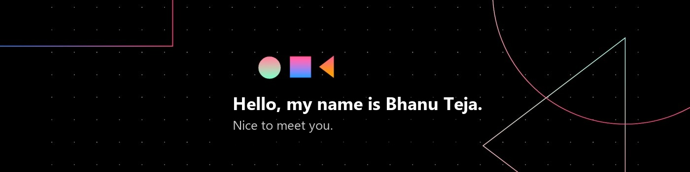

<!--Banner-->


<div align="center">

#  Hello, I'm **Bhanu Teja**! 


<br/>

<!-- Professional Intro Section -->
<table>
<tr>
<td width="60%" align="left">

### 🚀 **About Me**
**AI & Machine Learning Engineer and Full-Stack Developer** studying **B.Tech in Artificial Intelligence & Machine Learning** at **VNR VJIET, Hyderabad** (GPA: **9.42 / 10.0**). Passionate about architecting explainable machine learning pipelines, digital twin simulations, and high-performance full-stack applications.

**🎯 Currently Working On:**  
Explainable AI risk scoring systems (PHISHGUARD) and Real-Time Digital Twins for MALE UAV aero engines

**🌱 Learning & Growing:**  
Distributed Systems • Transformer Architecture Benchmarking • Advanced Spatial Indexing

**🤝 Open to Collaborate:**  
AI/ML Engineering • Full-Stack Web Development • Scalable System Design & Hackathons

**📊 Competitive Highlights:**  
LeetCode Rating: **1844** (Top 11.39%) • CodeChef: **Div 3 (1530)** • **490+** Problems Solved

</td>
<td width="40%" align="center">

### 🔗 **Quick Access**

*Explore my work, connect with me, and inspect my live engineering platforms*

<a href="https://aitha-bhanu-teja.vercel.app/" target="_blank">

</a>

<a href="https://aitha-bhanu-teja.vercel.app/bhanu_teja_resume.pdf" target="_blank">

</a>

<a href="https://www.linkedin.com/in/aitha-bhanu-teja-3b13a738b/" target="_blank">

</a>

<a href="https://leetcode.com/u/bhanuteja190707/" target="_blank">

</a>

<a href="https://www.codechef.com/users/bhanuteja1977" target="_blank">

</a>

<a href="https://github.com/bhanu-teja1977" target="_blank">

</a>

<a href="mailto:bhanuteja1977@gmail.com" target="_blank">

</a>

<a href="https://github.com/bhanu-teja1977" target="_blank">

</a>

</td>
</tr>
</table>

</div>

---

## 🚀 Tech Stack & Technologies

<div align="center">

**Programming Languages**
<p>
  
  
  
  
  
  
  
  
  
</p>

**AI & Machine Learning**
<p>
  
  
  
  
  
  
  
  
</p>

**Frontend Technologies**
<p>
  
  
  
  
  
</p>

**Backend & Microservices**
<p>
  
  
  
  
  
</p>

**Cloud & Databases**
<p>
  
  
  
  
  
  
</p>

**Developer Tools & Platforms**
<p>
  
  
  
  
  
  
</p>

</div>

---

## 🌟 Featured Engineering System

<div align="center">

### 🛡️ **PHISHGUARD** - Explainable Machine Learning Phishing URL Detection & Risk Scoring


**Detect, evaluate, and explain malicious URL threats in real time with high-accuracy gradient boosting and model interpretability**

🔍 **Lexical Feature Extraction** • 📈 **Gradient Boosting Ensembles** • 🔮 **SHAP Model Interpretability** • ⚡ **FastAPI Microservice**

*Engineered to eliminate black-box AI in cybersecurity by delivering granular 0–100 risk scoring with transparent feature attribution*

<br/>

### **✨ Key Architectural Highlights:**

<div align="center">

<table>
<tr>
<td width="50%">

🛡️ **Multi-Model Benchmarking:** Evaluated Logistic Regression, Random Forest, XGBoost, and LightGBM; selected LightGBM achieving **92% classification accuracy**.

🔍 **Explainable AI (SHAP):** Integrated TreeExplainer feature attributions to provide users with transparent reasons behind malicious verdicts.

🎯 **Dynamic Risk Scoring:** Generated calibrated continuous risk scores (0–100) combining heuristic indicators and model probability distributions.

</td>
<td width="50%">

⚡ **Sub-50ms REST API:** Built on asynchronous FastAPI with Pydantic schema validation for high-throughput enterprise URL scanning.

💻 **Modern Web Client:** Designed with React, Next.js, and Tailwind CSS with real-time risk gauges and interactive explanation waterfalls.

🧪 **Leakage-Safe Validation:** Trained on real-world phishing datasets with rigorous cross-validation and feature collinearity controls.

</td>
</tr>
</table>

</div>

<br/>

<a href="https://github.com/bhanu-teja1977" target="_blank">

</a>

<a href="https://aitha-bhanu-teja.vercel.app/#work" target="_blank">

</a>

</div>

---

## 💼 Professional Experience

### 🤖 **AI/ML Intern** | *ShadowFox* `Remote`
**📅 July 2026 – August 2026**
- 🚗 **Car Selling Price Prediction:** Developed an ML model to estimate car selling prices using vehicle features, statistical analysis, and regression modeling.
- 🗣️ **Language Model Analysis:** Implemented and benchmarked transformer-based language models for NLP, conducting token-level contextual analysis and text generation evaluation across benchmark datasets.
- 📊 **Validation Rigor:** Applied feature engineering, multicollinearity checks, and cross-validation pipelines to maximize model generalization.

### 🌐 **Full Stack Intern** | *VJ Startups* `On-Site, Hyderabad`
**📅 June 2026 – July 2026**
- 📜 **MOU Management System:** Developed a web-based platform to manage institutional MOUs, enterprise partnerships, student opportunities, and resource utilization.
- 📈 **MOU Analytics Dashboard:** Built real-time analytics dashboards to track MOU utilization metrics, collaborative activities, and venture milestones.
- ⚡ **Seamless Integration:** Integrated responsive React frontend interfaces with RESTful backend data APIs for smooth administrative tracking.

### 🏛️ **PR Coordinator** | *ISTE Student Chapter, VNR VJIET*
**📅 2025 – Present**
- 💻 Organized technical workshops and competitive coding contests for **400+ engineering students**.
- 📝 Prepared algorithmic problem statements and rigorous test cases in C++, Python, and Java.
- 🎤 Delivered keynote speeches during university student orientation and technical outreach programs.

### 🚀 **Wing Master & Program Manager** | *VJ Startups*
**📅 2025 – Present**
- 👥 Supervised cross-functional student teams across incubation programs and startup cohorts.
- 💡 Coordinated ideation challenges, pitch presentations, and developer sprint reviews.
- 🤝 Facilitated seamless communication between student innovators, faculty mentors, and external stakeholders.

---

## 🚀 Featured Projects

<table>
<tr>
<td width="50%">

### 🛡️ **PHISHGUARD - Explainable URL Risk Engine**
**Explainable Machine Learning Phishing URL Detection Platform**

🌐 **Demo / Portfolio:** [aitha-bhanu-teja.vercel.app](https://aitha-bhanu-teja.vercel.app/)

**✨ Key Features:**
- 🎯 Benchmarked Logistic Regression, Random Forest, XGBoost & LightGBM
- 🏆 **92% Accuracy** achieved with optimized LightGBM
- 🔍 SHAP-based explainable AI explaining feature attribution
- ⚡ Sub-50ms inference via asynchronous FastAPI microservice

**🛠️ Tech:** Python, Scikit-learn, LightGBM, XGBoost, SHAP, FastAPI, React.js

</td>
<td width="50%">

### ✈️ **AeroTwin - Digital Twin for MALE UAVs**
**Real-Time Digital Twin System for Aero Piston Engines**

💻 **GitHub:** [bhanu-teja1977/Digital_Twin](https://github.com/bhanu-teja1977/Digital_Twin)

**✨ Key Features:**
- ⚙️ Real-time cyber-physical digital twin simulation pipeline
- 📊 Real-time monitoring and combustion anomaly detection
- 📈 Predictive telemetry analysis for UAV aero piston engines
- 🛡️ Low-latency sensor ingestion and condition monitoring

**🛠️ Tech:** Python, FastAPI, Pandas, NumPy, IoT Telemetry, Streamlit

</td>
</tr>
<tr>
<td width="50%">

### 🚢 **GreenFleet-Q - AI Maritime Optimization**
**AI-Driven Maritime Decision-Support & Fuel Optimization Platform**

🏆 **Achievement:** Runner-Up, CONVERGENCE 2K26 Project Contest

**✨ Key Features:**
- 🌊 Random Forest & Quantum Particle Swarm Optimization (QPSO)
- ⛽ Predicts voyage fuel consumption and dynamic routing from weather data
- 🗺️ Interactive geospatial route visualizations with Leaflet & Recharts
- ⚡ High-performance FastAPI backend serving instant route inferences

**🛠️ Tech:** Python, FastAPI, Scikit-learn, Random Forest, QPSO, React.js

</td>
<td width="50%">

### 📡 **SignalSafe - Spatial ML Travel Connectivity**
**Cellular Connectivity Analysis & Signal Quality Prediction**

🌐 **Demo / Portfolio:** [aitha-bhanu-teja.vercel.app](https://aitha-bhanu-teja.vercel.app/)

**✨ Key Features:**
- 🚗 Evaluated real-world transit drive-test datasets
- 🗺️ Spatial indexing partitioning transit corridors
- 🔒 Leakage-safe group cross-validation preventing spatial overfitting
- 🌲 Ensemble regressor combining ExtraTrees and XGBoost

**🛠️ Tech:** Python, XGBoost, ExtraTrees, Spatial Indexing, FastAPI, Pandas

</td>
</tr>
<tr>
<td width="50%">

### 🌾 **GrainPulse - Grain Storage Monitoring**
**AI-Assisted Grain Storage Monitoring & Quality Assessment**

🌐 **Demo / Portfolio:** [aitha-bhanu-teja.vercel.app](https://aitha-bhanu-teja.vercel.app/)

**✨ Key Features:**
- 🌡️ Environmental anomaly detection (temperature & humidity)
- ⚠️ Automated spoilage risk triggers preventing post-harvest grain losses
- 🧪 Fully validated backend test suites and frontend production builds
- 📱 Decentralized monitoring dashboard designed for silos and storage facilities

**🛠️ Tech:** Python, FastAPI, React.js, IoT Telemetry, Tailwind CSS

</td>
<td width="50%">

### 🌐 **DrishyaMitra - Full-Stack MERN Platform**
**Responsive MERN Web Application with Intuitive Interface & REST APIs**

💻 **GitHub:** [bhanu-teja1977](https://github.com/bhanu-teja1977)

**✨ Key Features:**
- 🔐 Secure user authentication and authorization workflows
- 📦 Modular RESTful API architecture with MongoDB persistence
- ⚡ Full CRUD operations with responsive Tailwind CSS components
- 📱 100% mobile-friendly responsive state management

**🛠️ Tech:** React.js, Node.js, Express.js, MongoDB, REST APIs, Tailwind CSS

</td>
</tr>
<tr>
<td width="50%">

### 🚆 **Railway Management System**
**Object-Oriented Java Database Application with JDBC & MySQL**

💻 **GitHub:** [bhanu-teja1977](https://github.com/bhanu-teja1977)

**✨ Key Features:**
- 🚂 Train scheduling, ticket booking, and passenger record management
- 🔒 Parameterized queries preventing SQL injection vulnerabilities
- 🗄️ Relational MySQL schema with foreign keys and ACID transactions
- ☕ Robust Object-Oriented Programming (OOPS) design patterns

**🛠️ Tech:** Java, MySQL, JDBC, Object-Oriented Programming (OOPS)

</td>
<td width="50%">

### 💻 **Developer Portfolio 3D**
**High-Performance Developer Portfolio with Interactive CLI & Smooth Physics**

🌐 **Live:** [aitha-bhanu-teja.vercel.app](https://aitha-bhanu-teja.vercel.app/)

**✨ Key Features:**
- 🖥️ Interactive developer CLI terminal with custom system commands
- 🎨 Fluid cursor simulation, 3D PinContainers & Bento grids
- 📄 Direct resume download and verified contact messaging
- ⚡ 100% responsive, dark-mode first, optimized for recruiter review

**🛠️ Tech:** React, TypeScript, Vite, Tailwind CSS, Framer Motion, Lenis

</td>
</tr>
</table>

---

## 🎯 Skills & Core Competencies

<div align="center">

### 🔧 **Technical Expertise**
| Category | Skills |
|----------|--------|
| **🔧 Data Structures** | Arrays, Linked Lists, Trees, Binary Search Trees, Graphs, Hash Maps, Stacks, Queues, Heaps |
| **⚡ Algorithms** | Dynamic Programming, Greedy, Graph Traversal (BFS/DFS), Divide & Conquer, Backtracking |
| **🤖 AI & Machine Learning** | Scikit-learn, LightGBM, XGBoost, SHAP (XAI), Transformers, HuggingFace, Pandas, NumPy |
| **🎨 Frontend** | React.js, Next.js, TypeScript, JavaScript (ES6+), Tailwind CSS, Bootstrap, Framer Motion |
| **⚙️ Backend** | FastAPI, Node.js, Express.js, RESTful APIs, Python, Java, JDBC |
| **☁️ Cloud & Database** | AWS Cloud Practitioner, MySQL, MongoDB, PostgreSQL, Supabase, Firebase |
| **🛠️ Developer Tools** | Git, GitHub, Docker, Postman, Linux / Bash, VS Code, Jupyter Notebook |
| **🏛️ Core Computer Science** | Object-Oriented Programming (OOPS), DBMS, Operating Systems, System Design & Scalability |

### 🧠 **Soft Skills & Core Competencies**
```
💡 Problem Solving  •  🧮 Analytical & Algorithmic Thinking  •  🤝 Cross-Functional Collaboration
🎯 Decision Making  •  👥 Leadership & Mentorship  •  🗣️ Public Speaking & Presentations
⏰ Time Management  •  🔍 Critical Thinking  •  📊 System Architecture & Scalability
```

### 📊 **Specialized Areas**
<table>
<tr>
<td width="33%" align="center">

**🤖 AI & Machine Learning**
- Gradient Boosting (LightGBM, XGBoost)
- Explainable AI (SHAP Interpretability)
- Transformer & NLP Benchmarking
- Feature Engineering & Validation
- Spatial ML & Correlated Data Splitting
- Regression & Classification Pipelines

</td>
<td width="33%" align="center">

**💻 Full-Stack Architecture**
- Asynchronous FastAPI Microservices
- MERN Stack Web Applications
- RESTful API Architecture
- ACID Relational & NoSQL Databases
- Secure Authentication & Authorization
- Responsive Modern UI/UX

</td>
<td width="33%" align="center">

**⚡ Systems & Algorithms**
- Competitive Programming (LeetCode 1844)
- Distributed System Design & Scalability
- Object-Oriented Design Patterns
- Real-Time Digital Twin Architectures
- Telemetry & Sensor Stream Ingestion
- High-Throughput Request Handling

</td>
</tr>
</table>

</div>

---

## 🏆 Certifications & Learning Journey

<details>
<summary><b>🏆 Click to view all certifications & credentials</b></summary>

| 📅 Year | 🏢 Provider | 📚 Certification / Credential | 🎯 Status |
|:-------:|:-----------:|:------------------------------|:---------:|
| **2025** | **Oracle** | **Oracle Cloud Infrastructure 2025 Certified AI Foundations Associate** | ✅ Certified |
| **2025** | **Amazon Web Services (AWS)** | **AWS Cloud Practitioner Essentials** | ✅ Certified |
| **2024** | **VNR VJIET** | **Data Structures & Algorithmic Foundations** | ✅ Completed |
| **2024** | **Hugging Face** | **Transformer Architectures & NLP Representation** | ✅ Completed |

</details>

### 🥇 **Notable Achievements & Competitive Rankings**

🏆 **Winner — Scale Challenge (System Design), CONVERGENCE 2K26**
   - Won **1st Place** at VNR VJIET by architecting a scalable, fault-tolerant, high-performance distributed system for a real-world problem.

🥈 **Runner-Up — Project Contest, CONVERGENCE 2K26**
   - Secured **2nd Place** in Idea Pitching and technical demonstration with **Team TechnoForge** for **GreenFleet-Q** (AI-driven maritime optimization platform).

🥉 **3rd Prize Winner — Vistera 2K26**
   - Won 3rd Prize among **1,600+ participants and 425+ teams** for technical innovation and algorithmic implementation.

⚡ **Competitive Programming Excellence:**
- 🟡 **LeetCode Contest Rating: 1844** (Top **11.39%** globally) • **229+** Problems Solved ([Profile](https://leetcode.com/u/bhanuteja190707/))
- 🟤 **CodeChef Division 3:** Max Rating **1530** • **264+** Problems Solved ([Profile](https://www.codechef.com/users/bhanuteja1977))
- 📈 **490+ Total Algorithmic Problems Solved** across LeetCode, CodeChef, and contest platforms.

---

## 🤝 Volunteer Experience & Community Leadership

### 🌟 **Empowering Student Innovators & Developers**

As **PR Coordinator** for the **ISTE Student Chapter** and **Wing Master & Program Manager** at **VJ Startups**, I actively mentor peers, design technical challenges, and build collaborative platforms for aspiring engineers.

**🎯 My Mission:** Bridging the gap between theoretical computer science and production-grade engineering through hands-on technical workshops, competitive programming contests, and startup incubation.

**📈 Impact Achieved:**
- **400+ students** engaged in competitive coding workshops and algorithmic contests.
- **20+ challenging problem statements** and test suites curated for university algorithmic competitions.
- **Multiple startup cohorts** mentored through ideation, technical architecture review, and pitch preparation.
- **Keynote speeches** delivered during university student orientation and technical outreach programs.

**🏆 Leadership Roles:**

<div align="center">

| Role | Organization | Duration | Key Responsibilities |
|:-----|:-------------|:--------:|:---------------------|
| **📢 PR Coordinator** | ISTE Student Chapter, VNR VJIET | 2025 – Present | Technical workshops, contest problem preparation, orientation speaker |
| **🚀 Wing Master & Program Manager** | VJ Startups | 2025 – Present | Student innovation cohorts, sprint reviews, mentor-startup coordination |
| **🤝 Full Stack Developer & Intern** | VJ Startups | Jun 2026 – Jul 2026 | Enterprise MOU management system & institutional analytics dashboards |

</div>

---

## 🎓 Education & Academic Excellence

<table>
<tr>
<td width="50%">

### 🏛️ **VNR Vignana Jyothi Institute of Engineering & Technology**
**📅 2024 – Present (3rd Year)**

🎓 **Bachelor of Technology (B.Tech)** - Artificial Intelligence & Machine Learning / CSE  
📊 **Cumulative GPA**: **9.42 / 10.0**  
📍 Hyderabad, Telangana, India

**📚 Core Coursework:**
- Data Structures & Algorithms
- Artificial Intelligence & Machine Learning
- Database Management Systems (DBMS)
- Object-Oriented Programming (OOPS)
- Operating Systems & Computer Networks
- System Design & Distributed Systems

</td>
<td width="50%">

### 🏫 **Junior College & High School**

### **Narayana Junior College, Hyderabad**
**📅 2022 – 2024 (Class XI–XII)**  
📖 **Stream:** MPC (Mathematics, Physics, Chemistry)  
📊 **Score**: **98.6%** 🏅

---

### **Kakatiya High School, Nizamabad**
**📅 2021 – 2022 (Class X)**  
📖 **Board:** SSC Board of Secondary Education  
📊 **GPA**: **10.00 / 10.00** (Perfect Score) 🏅

**🏅 Consistent Academic Excellence:**
- Maintained top 1% academic rankings throughout schooling and undergraduate studies.

</td>
</tr>
</table>

---

## 📊 GitHub Analytics & Development Insights

<div align="center">

### 📈 **Coding Journey & Statistics**

<table>
<tr>
<td width="50%">


</td>
<td width="50%">


</td>
</tr>
</table>


<br/>


<br/>

### 🏆 **Development Highlights**

<table>
<tr>
<td width="25%" align="center">

**⚡ LeetCode Rating**
### 1844
*Top 11.39% Globally*

</td>
<td width="25%" align="center">

**🍲 CodeChef**
### Div 3 (1530)
*264+ Solved*

</td>
<td width="25%" align="center">

**🧩 Problems Solved**
### 490+
*DSA & Algorithms*

</td>
<td width="25%" align="center">

**🎓 Academic CGPA**
### 9.42 / 10
*VNR VJIET (B.Tech)*

</td>
</tr>
</table>

### 🎯 **Primary Technologies**
<table>
  <tr>
    <td align="center">🥇 <strong>Python</strong> • <code>ML & FastAPI</code></td>
    <td align="center">🥈 <strong>React.js</strong> • <code>Frontend Architecture</code></td>
    <td align="center">🥉 <strong>C++</strong> • <code>DSA & Competitive</code></td>
  </tr>
  <tr>
    <td align="center">🏅 <strong>TypeScript</strong> • <code>Full-Stack</code></td>
    <td align="center">🏅 <strong>Node.js / Express</strong> • <code>REST APIs</code></td>
    <td align="center">🏅 <strong>MySQL & MongoDB</strong> • <code>Databases</code></td>
  </tr>
</table>

</div>

---

<!--Dynamic Quote card updates everyday at 12 PM-->  
<h2 align="center">🌟 Tʜᴏᴜɢʜᴛ ᴏғ ᴛʜᴇ Dᴀʏ 🌟</h2>  
<!--STARTS_HERE_QUOTE_CARD--> 
<p align="center">     
   
</p> 
<!--ENDS_HERE_QUOTE_CARD-->

---

## 🌐 Let's Connect & Build Next-Level Systems Together!

<div align="center">

<table>
<tr>
<td width="30%" align="center">

### 🧑‍💻 **Meet Bhanu Teja**

**🤖 AI/ML Engineer**  
**💻 Full-Stack Developer**  
**⚡ Problem Solver (LeetCode 1844)**

*Engineering practical AI systems, resilient web architectures, and scalable code*

</td>
<td width="70%" align="center">

### 💬 **Ready to Collaborate?**

**I am actively seeking AI/ML, Machine Learning, and Software Development internships! I am always excited to discuss engineering architectures, build impactful platforms, and solve challenging problems.**

*🎯 Open for internships & projects • 💡 Passionate about practical AI • 🤝 Always ready to collaborate*

<br/>

**📬 Get In Touch:**

<a href="mailto:bhanuteja1977@gmail.com" target="_blank">

</a>
<a href="https://www.linkedin.com/in/aitha-bhanu-teja-3b13a738b/" target="_blank">

</a>
<a href="https://github.com/bhanu-teja1977" target="_blank">

</a>
<a href="https://leetcode.com/u/bhanuteja190707/" target="_blank">

</a>
<a href="https://www.codechef.com/users/bhanuteja1977" target="_blank">

</a>
<a href="https://aitha-bhanu-teja.vercel.app/" target="_blank">

</a>

</td>
</tr>
</table>

<br/>

### 🎯 **What I Bring to the Table**

<table>
<tr>
<td width="25%" align="center">

**🤖 Machine Learning**
LightGBM, XGBoost, SHAP, Transformers, Spatial ML

</td>
<td width="25%" align="center">

**💻 Full-Stack Development**
FastAPI, React.js, Next.js, Node.js, Express, MongoDB

</td>
<td width="25%" align="center">

**⚡ Algorithmic Depth**
LeetCode 1844, CodeChef 1530, 490+ Solved, Scale Challenge 1st

</td>
<td width="25%" align="center">

**🤝 Leadership & Communication**
ISTE PR Coordinator, VJ Startups Program Manager

</td>
</tr>
</table>

### 💼 **Looking For Opportunities In:**

```
🚀 AI & Machine Learning Internships  •  🤖 Machine Learning Engineer Internships
💻 Full-Stack Developer Internships   •  🐍 Python & Backend Developer Roles
⚡ Software Development Internships  •  🧠 Scalable System Design & AI Solutions
```

### 📞 **Quick Contact**
```
📧 bhanuteja1977@gmail.com  |  📱 +91 868-8928-793  |  🌐 aitha-bhanu-teja.vercel.app
```

<br/>

### ☕ **Support My Work**

<a href="https://github.com/bhanu-teja1977" target="_blank">

</a>

*Star my repositories on GitHub and follow my journey as I build next-generation AI and full-stack systems!*

</div>

---

<div align="center">
  
  
  **✨ "Solving real-world problems through machine learning, scalable code, and algorithmic clarity" ✨**
  
  <br/><br/>
  
  **🌟 Thanks for visiting my profile! Star ⭐ my repositories if you find them interesting! 🌟**
</div>

<!--Footer--> 
<p align="center">
  
</p>
